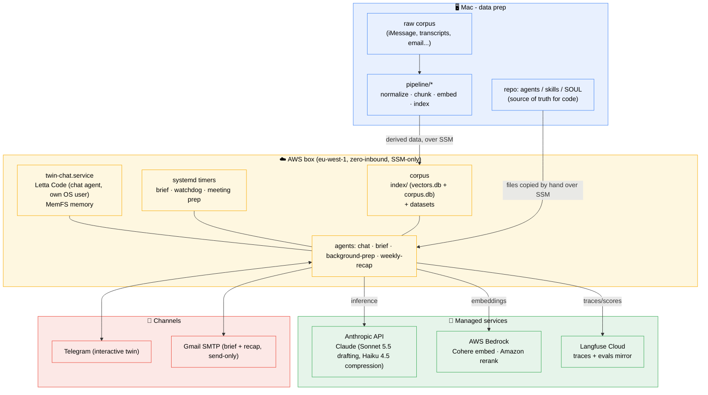
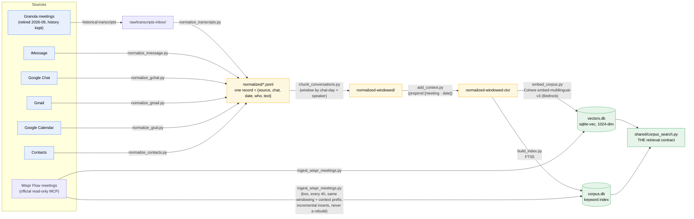
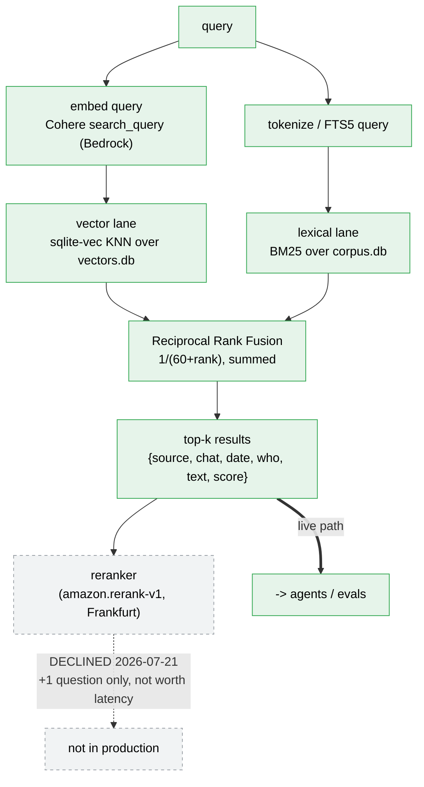
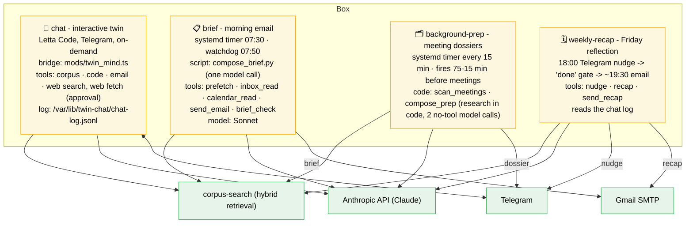
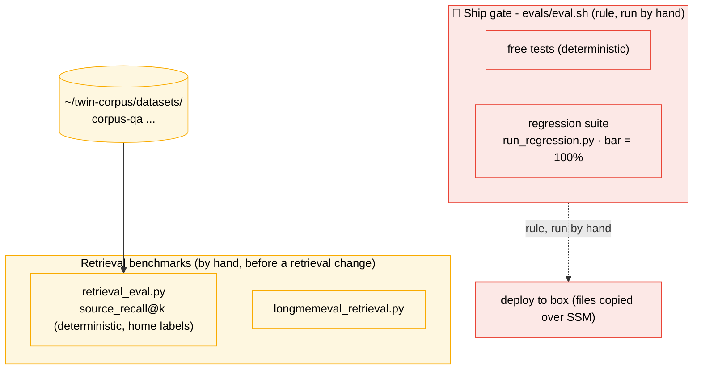
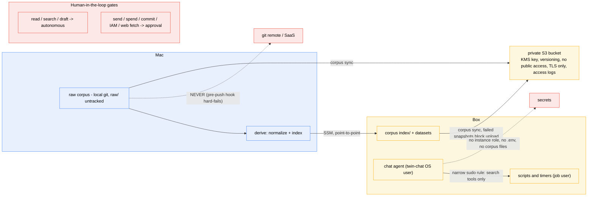

 # Twin Mind - Architecture Map

A full visual map of the system: where data lives, how the corpus becomes retrievable, the agents that run, the eval gates, and the governance rules.
View this in Zed, GitHub, or a Mermaid live editor to render the diagrams.

Ground truths this reflects: `CLAUDE.md`, `docs/2026-06-30-twin-mind-design.md`, `docs/2026-07-17-corpus-chunking-design.md`, `docs/CHANGELOG.md`.

---

## 1. System at a glance

Where the three worlds sit - the Mac (data prep), the AWS box (the always-on twin), and the channels Daniel touches.
Since 2026-09-23 the corpus, raw tier included, is also backed up to a private encrypted S3 bucket (see `CLAUDE.md`).

---

## 2. The RAG data pipeline (raw → retrievable)

How a message or meeting becomes something the twin can search.
This is the pipeline the 2026-07-21 work upgraded: windowed chunking + contextual embedding, promoted to production on both lanes.

---

## 3. Inside the retriever (hybrid search)

What `corpus-search` actually does for one query. Default mode = hybrid.
The reranker rung was **built and measured but declined** (marginal gain), so it is not in the live path.

---

## 4. The agents (what runs, when)

Four agents, each a folder under `agents/`. Only chat is a long-running agent, on Letta Code. The other three are scripts that systemd timers start.
All read the corpus through `corpus-search`; all Claude inference goes through the Anthropic API (`shared/claude.py`), embeddings through Bedrock.

---

## 5. The eval stack

The rule is that nothing ships without the gate. The gate is run by hand, because there is no deploy CI. Retrieval and generation are measured separately (RAGAS split); everything mirrors to Langfuse.

---

## 6. Governance and data flow (the rules that constrain everything)

The non-negotiables: the corpus leaves the Mac only to the controlled S3 bucket, never to a code remote.
The chat agent cannot reach secrets or the corpus files.
Humans approve anything irreversible.

---

## Legend / key facts

| Thing | Value |
|---|---|
| Box | One private EC2 host, t4g.small, eu-west-1, zero-inbound, SSM-only. Not a git checkout; deploys are files copied by hand over SSM |
| Chat agent | Letta Code 0.34.41, self-hosted, `twin-chat.service`, own OS user `twin-chat`, Sonnet 5.5. Bridge: `agents/chat/mods/twin_mind.ts`. Chat log: `/var/lib/twin-chat/chat-log.jsonl` (`shared/chat_log.py`). Hermes is stopped, kept for rollback |
| Scheduled jobs | systemd timers (`infra/systemd/`): morning-brief, morning-brief-watchdog, meeting-prep-poller |
| Inference | Anthropic API since 2026-10-22: Claude Sonnet 5.5 drafting (since 2026-10-23), Haiku 4.5 compression; key from Secrets Manager `aws-inference`. Bedrock keeps Cohere embed-multilingual-v3 and Amazon rerank (eu-central-1) |
| Retrieval | Hybrid (FTS5 + sqlite-vec + RRF) via `corpus-search`; windowed + contextual chunks (promoted 2026-07-21) |
| Observability | Langfuse Cloud (free tier) is the only trace store |
| Channels | Telegram Bot API (interactive), Gmail SMTP (brief + recap, send-only, recipient-locked) |
| Hard rules | corpus never to a code remote · ship gate green before deploy (by hand) · approval for send/spend/irreversible and for each web fetch |
